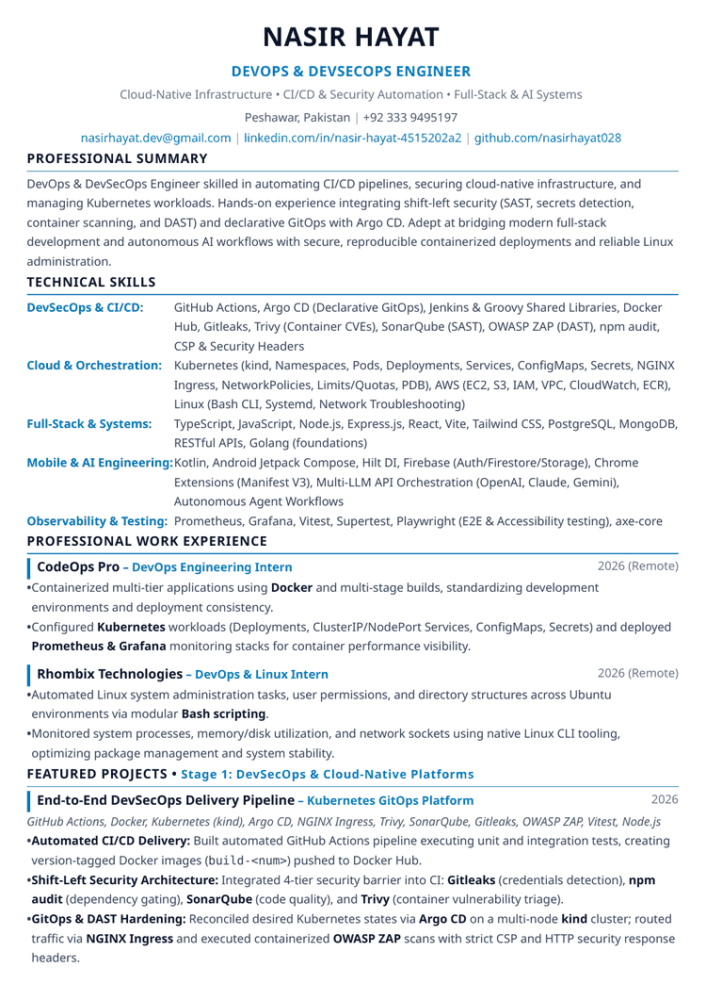
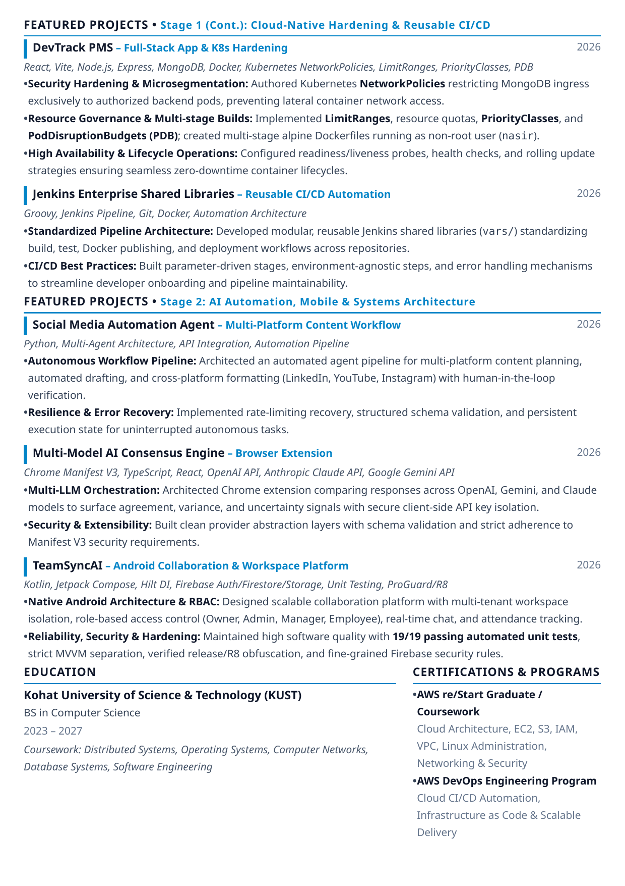

# Nasir Hayat — DevOps & DevSecOps Engineer

[](#)
[](https://github.com/nasirhayat028/devops-resume/actions/workflows/build-pdf.yml)
[](#)
[-blueviolet.svg)](#)
[](LICENSE)

This repository contains the source code, build automation, and compiled deliverables for the professional **Master Resume** of **Nasir Hayat**, DevOps & DevSecOps Engineer specializing in Cloud-Native Infrastructure, CI/CD Security Automation, Full-Stack Development, and AI Systems.

---

## 📄 Deliverables & Documents

| Document | Format | Description |
| :--- | :---: | :--- |
| **[Nasir_Hayat_Master_Resume.pdf](./Nasir_Hayat_Master_Resume.pdf)** ([Direct Download](https://github.com/nasirhayat028/devops-resume/releases/tag/latest)) | `PDF (A4)` | **Flagship 2-page master resume**, pixel-perfect typography, strictly formatted for international & remote roles. |
| **[Nasir_Hayat_Master_Resume.html](./Nasir_Hayat_Master_Resume.html)** | `HTML` | Semantic HTML template with corporate design system and custom print styles. |
| **[Nasir_Hayat_Master_Resume.md](./Nasir_Hayat_Master_Resume.md)** | `Markdown` | ATS-first plain markdown source for instant job portal parsing and copy-pasting. |
| **[generate_master_resume.py](./generate_master_resume.py)** | `Python` | Automated Qt/PySide6 rendering engine producing exact 595x842 pt A4 vector PDFs. |

---

## 🖼️ Visual Previews

<div align="center">

### Page 1: Cloud-Native DevSecOps, Skills Matrix & Work Experience


<br/><br/>

### Page 2: Hardened Systems, AI Agents, Education & Certifications


</div>

---

## 🛠️ Key Technical Highlights in Resume

* **DevSecOps & CI/CD:** GitHub Actions, Argo CD (Declarative GitOps), Jenkins & Groovy Shared Libraries, Docker Hub, Gitleaks, Trivy (Container CVEs), SonarQube (SAST), OWASP ZAP (DAST), npm audit, CSP & Security Headers.
* **Cloud & Orchestration:** Kubernetes (kind, Namespaces, Pods, Deployments, Services, ConfigMaps, Secrets, NGINX Ingress, NetworkPolicies, Limits/Quotas, PDB), AWS (EC2, S3, IAM, VPC, CloudWatch, ECR), Linux (Bash CLI, Systemd, Network Troubleshooting).
* **Full-Stack & Systems:** TypeScript, JavaScript, Node.js, Express.js, React, Vite, Tailwind CSS, PostgreSQL, MongoDB, RESTful APIs, Golang (foundations).
* **Mobile & AI Engineering:** Kotlin, Android Jetpack Compose, Hilt DI, Firebase (Auth/Firestore/Storage), Chrome Extensions (Manifest V3), Multi-LLM API Orchestration (OpenAI, Claude, Gemini), Autonomous Agent Workflows.
* **Observability & Testing:** Prometheus, Grafana, Vitest, Supertest, Playwright (E2E & Accessibility testing), axe-core.

---

## 🚀 How to Build / Generate Locally

### Prerequisites
* Python 3.10+
* PySide6 (`pip install PySide6`)
* Poppler utils (optional, for PDF preview generation: `sudo apt install poppler-utils`)

### Build Command
```bash
# Set offscreen platform for headless environments
export QT_QPA_PLATFORM=offscreen

# Run generator to build HTML and 2-page vector PDF
python3 generate_master_resume.py
```

---

## 📬 Contact & Profiles

* **Email:** [nasirhayat.dev@gmail.com](mailto:nasirhayat.dev@gmail.com)
* **LinkedIn:** [linkedin.com/in/nasir-hayat-4515202a2](https://www.linkedin.com/in/nasir-hayat-4515202a2)
* **GitHub:** [github.com/nasirhayat028](https://github.com/nasirhayat028)
* **Location:** Peshawar, Pakistan • +92 333 9495197
