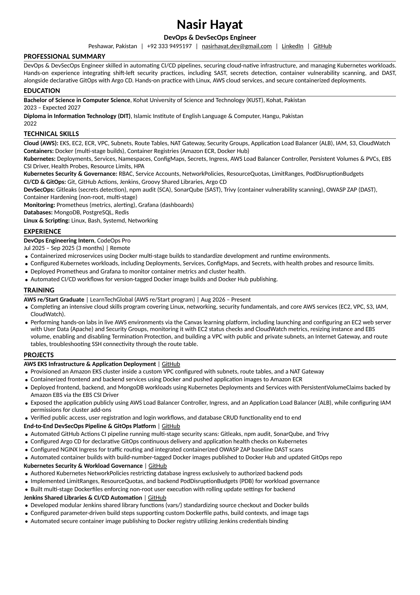

# Nasir Hayat — DevOps & DevSecOps Engineer CV

[](#)
[](#)
[-blueviolet.svg)](#)
[](LICENSE)

This repository contains the source code, build automation, and compiled deliverables for the professional **1-Page ATS-Compliant CV** of **Nasir Hayat**, DevOps & DevSecOps Engineer specializing in Cloud-Native Infrastructure, Kubernetes Workload Governance, CI/CD Shift-Left Security, and GitOps Automation.

---

## 📄 Deliverables & Documents

| Document | Format | Description |
| :--- | :---: | :--- |
| **[Nasir_Hayat_CV.pdf](./Nasir_Hayat_CV.pdf)** | `PDF (A4)` | **Single-page ATS-optimized CV**, strictly formatted with clean typography, verified margins, and embedded hyperlinks. |
| **[Nasir_Hayat_CV.docx](./Nasir_Hayat_CV.docx)** | `DOCX` | Editable Microsoft Word format adhering to single-column ATS standards. |
| **[Nasir_Hayat_CV.html](./Nasir_Hayat_CV.html)** | `HTML` | Semantic HTML print template with Carlito typography and calibrated print stylesheets. |
| **[build_cv.py](./build_cv.py)** | `Python` | Automated generator script compiling the DOCX, HTML, and headless Chrome vector PDF. |

---

## 🖼️ Visual Preview

<div align="center">
  
</div>

---

## 🛠️ Key Technical Highlights

* **Cloud & Infrastructure (AWS):** Amazon EKS, EC2, ECR, VPC, Subnets, Route Tables, NAT Gateway, Security Groups, Application Load Balancer (ALB), IAM, S3, CloudWatch.
* **Containers & Orchestration:** Docker (multi-stage builds), Amazon ECR, Docker Hub, Kubernetes (Deployments, Services, Namespaces, ConfigMaps, Secrets, Ingress, AWS Load Balancer Controller, Persistent Volumes, EBS CSI Driver, HPA, Health Probes, Resource Limits).
* **Kubernetes Security & Governance:** RBAC, Service Accounts, NetworkPolicies, ResourceQuotas, LimitRanges, PodDisruptionBudgets (PDB), Non-Root Containers.
* **CI/CD & GitOps Automation:** GitHub Actions, Jenkins, Groovy Shared Libraries, Argo CD (declarative continuous delivery).
* **DevSecOps & Shift-Left Security:** Gitleaks (secrets scanning), npm audit (SCA), SonarQube (SAST), Trivy (container vulnerability scanning), OWASP ZAP (DAST).
* **Observability & Databases:** Prometheus (metrics & alerts), Grafana (dashboards), MongoDB, PostgreSQL, Redis.
* **Linux & Systems:** Linux administration, Bash automation, Systemd services, networking troubleshooting.

---

## 🚀 Projects Featured

1. **[AWS EKS Infrastructure & Application Deployment](https://github.com/nasirhayat028/notes-app-aws-eks-deployment)** — Production EKS cluster inside custom VPC with subnets, NAT Gateway, EBS CSI driver storage, ALB Ingress, and containerized microservices.
2. **[End-to-End DevSecOps Pipeline & GitOps Platform](https://github.com/nasirhayat028/notes-webapp)** — Multi-stage GitHub Actions security pipeline (Gitleaks, npm audit, SonarQube, Trivy, OWASP ZAP) with declarative Argo CD Kubernetes deployments.
3. **[Kubernetes Security & Workload Governance](https://github.com/nasirhayat028/devtrack-pms-DevSecOps)** — Strict NetworkPolicies restricting database access, LimitRanges, ResourceQuotas, PDBs, and hardened multi-stage Dockerfiles.
4. **[Jenkins Shared Libraries & CI/CD Automation](https://github.com/nasirhayat028/jenkins-shared-libraries-01)** — Reusable Groovy shared libraries (`vars/`) standardizing Docker builds, parameter-driven pipelines, and credential bindings.

---

## 💻 How to Build Locally

### Prerequisites
* Python 3.10+
* Google Chrome (for headless PDF generation)
* Dependencies:
  ```bash
  pip install python-docx
  ```

### Build Command
```bash
python3 build_cv.py
```
This generates:
- `Nasir_Hayat_CV.docx`
- `Nasir_Hayat_CV.html`
- `Nasir_Hayat_CV.pdf` (Strict 1-page output)

---

## 📬 Contact & Profiles

* **Email:** [nasirhayat.dev@gmail.com](mailto:nasirhayat.dev@gmail.com)
* **LinkedIn:** [linkedin.com/in/nasir-hayat-4515202a2](https://www.linkedin.com/in/nasir-hayat-4515202a2)
* **GitHub:** [github.com/nasirhayat028](https://github.com/nasirhayat028)
* **Location:** Peshawar, Pakistan • +92 333 9495197
